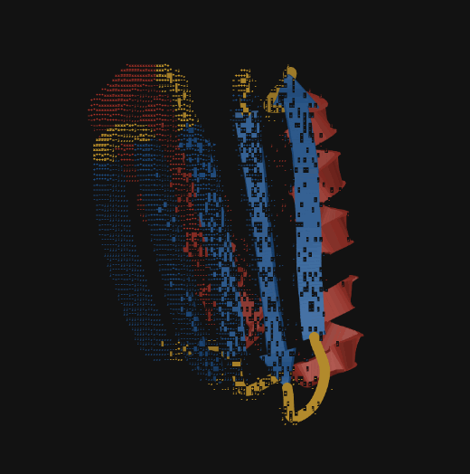
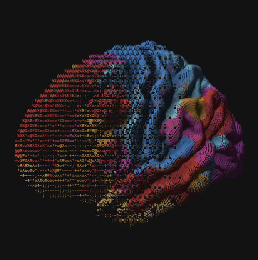

<p align="center">
  
</p>

<p align="center"><code>neuroscience + biochemistry</code> at <code>university of washington</code><br><code>consciousness</code> <code>molecular design</code> <code>addiction</code></p>

<p align="center">
  
  
</p>

<p align="center"><sub>left: top7, a computationally designed protein (pdb 1qys). right: the cortex from gyrus, colored by yeo network.</sub></p>

What I really want to understand is consciousness, and especially the hard problem of consciousness; that is, how biological computation leads to subjective experience, or qualia. 'How is it that a collection of neurons get together in just the right way to experience the world as we do?'

I also want to be able to design molecules, because I think that's really cool and because if I could do that, maybe I could make molecules that were less destructively (and structurally) addictive. Addiction is where those two meet, since it is not something you can objectively measure. It is also one of the hardest things to research, since you can't really measure "wanting".

So far, this has meant protein design at the Institute for Protein Design and neuropharma at UW SoM, alongside AI at NASA; of course, I feel like there's more to discover.

```text
$ ls ~/work

molecule
  protein design
  institute for protein design
     │
     ▼
circuit
  addiction, cannabinoids
  stella + bruchas labs, uw
     │
     ▼
experience
  consciousness, qualia
  the hard problem
```

```text
$ cat credentials.txt

institute for protein design
  researcher, king lab
nasa kennedy space center
  ml / ai engineering intern
  ostem, 0.7% accepted
uw medicine
  pharmacology + psychiatry
  stella + bruchas labs
american academy of pediatrics
  technical expert panelist
  youth panel, 3 of 1,800
uw neuroscience
  neusci 440 peer facilitator
```

```text
$ tree ~/projects

projects
├── gyrus
│   3d brain atlas in webgl
│   186 regions, 7 parcellations
│   628 pubmed-checked entries
├── orbit
│   retrieval for nasa kennedy
│   bm25 + vector + graph search
└── recoverpath
    opioid recovery app
    led 88 interns across 6 teams
```

```text
$ which tools

python  r  javascript  three.js
nilearn  sleap  playwright
```

<p align="center">
  <a href="https://www.linkedin.com/in/everett-freeman-b3b4ba2ab/"><code>linkedin</code></a>
</p>

<p align="center"><sub>protein drawn with <a href="https://github.com/mitsenkov/ascii-fold">ascii-fold</a> by maxim tsenkov. top7 from kuhlman et al., science 2003.</sub></p>
